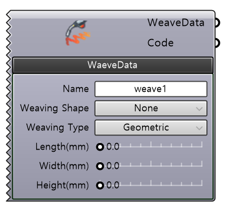

🌐 [EN]( {{ page.translation_link | absolute_url }} ){: .lang-switch }

# Description

아크 용접 중 수행되는 위빙(Weaving) 모션을 정의하는 컴포넌트이다. 위빙 형상, 진폭, 주파수 파라미터를 지정한다.
 

## | 필수 파라미터 (Required Parameter)

  <input type="radio" id="sm-tab1" name="gh-tabs-weavedata" checked>
  <ul class="tab-buttons">
    <li><label for="sm-tab1">WeaveData</label></li>
  </ul>
  

    <table class="spec-table">
      <thead>
        <tr>
          <th>이름</th>
          <th>타입</th>
          <th>설명</th>
        </tr>
      </thead>
      <tbody>
        <tr>
          <td><strong>Name</strong></td>
          <td>String</td>
          <td>생성할 <code>WeaveData</code>의 변수명을 정의한다.</td>
        </tr>
        <tr>
          <td><strong>Weaving Shape</strong></td>
          <td>String</td>
          <td>위빙 패턴 모양을 지정한다. [0]: 없음, [1]: 지그재그(수평), [2]: V형(수직), [3]: 삼각형(수직), [4]: 원형(수직)</td>
        </tr>
        <tr>
          <td><strong>Weaving Type</strong></td>
          <td>String</td>
          <td>위빙 모션에 사용되는 로봇 축 제어 방식을 선택한다. 
              [0]: Geometric - 전체 축(1-6) 활용 (주파수↓ / 정확도↑) 
              [1]: Wrist - 손목축(4-6) 위주 + 메인축(1-3) 미세보정 (주파수↑ / 정확도↓) 
              [2]: Rapid1 - 메인축(1-3) 활용 (Legacy) 
              [3]: Rapid2 - 손목축(4-6) 활용 (Legacy)</td>
        </tr>        
        <tr>
          <td><strong>Length(mm)</strong></td>
          <td>Number</td>
          <td>• Type이 Geometric/Wrist인 경우: 위빙 사이클 길이 (mm) 
              • Type이 Rapid1/Rapid2인 경우: 위빙 사이클 주파수 (Hz) 
              • Shape이 Circular인 경우: 원형 패턴 간격</td>
        </tr>
        <tr>
          <td><strong>Width(mm)</strong></td>
          <td>Number</td>
          <td>위빙 패턴의 전체 진폭 (mm)을 설정한다. (원형 위빙의 경우 반지름)</td>
        </tr>
        <tr>
          <td><strong>Height(mm)</strong></td>
          <td>Number</td>
          <td>패턴의 수직 높이 (mm)를 설정한다. V형 및 삼각형 패턴에서만 사용되며, 지그재그 및 원형 패턴에서는 무시된다.</td>
        </tr>
      </tbody>
    </table>
  

# | 출력(Outputs)

| 이름 | 타입 | 설명 |
| :--- | :--- | :--- |
| **WeaveData** | WeaveData | 정의된 ABB WeaveData를 출력한다. |
| **Code** | String | 생성된 RAPID 코드 구문을 출력한다. |