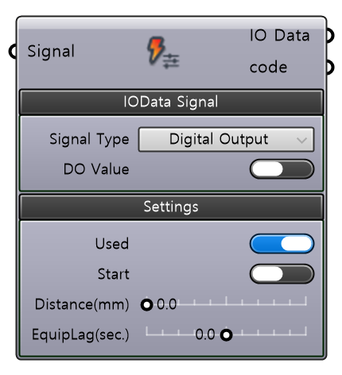
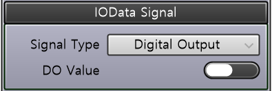
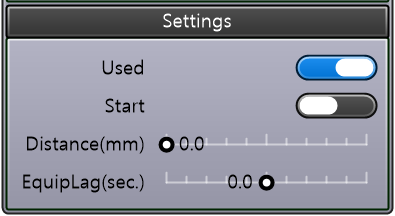

🌐 [KR]( {{ page.translation_link | absolute_url }} ){: .lang-switch }

# Description

Defines a single I/O trigger event for a TriggIOs array. Specifies the target output signal, trigger position along the path, and configuration values. Multiple IOEvents can be grouped into the TriggIOs component to construct TriggIOs data.

  

# | Inputs

| Name | Type | Description |
| :--- | :--- | :--- |
| **Signal** | String | Inputs the signal data. |

## | Required Parameter

  <input type="radio" id="tab1" name="gh-tabs-1" checked>
  <ul class="tab-buttons">
    <li><label for="tab1">IOData Signal</label></li>
  </ul>
  

    <table class="spec-table" style="margin: 0;">
      <thead>
        <tr>
          <th>Name</th>
          <th>Type</th>
          <th>Description</th>
        </tr>
      </thead>
      <tbody>
        <tr>
          <td><strong>Signal Type</strong></td>
          <td>Dropdown</td>
          <td>Specifies the output signal type (Digital / Group / Analog).</td>
        </tr>
        <tr>
          <td><strong>DO Value</strong></td>
          <td>Boolean</td>
          <td>Sets whether the event is enabled (True: enabled / False: disabled).</td>
        </tr>
      </tbody>
    </table>

  

  

  <input type="radio" id="tab2" name="gh-tabs-2" checked>
  <ul class="tab-buttons">
    <li><label for="tab2">Settings</label></li>
  </ul>
  

    <table class="spec-table" style="margin: 0 0 20px 0;">
      <thead>
        <tr>
          <th>Name</th>
          <th>Type</th>
          <th>Description</th>
        </tr>
      </thead>
      <tbody>
        <tr>
          <td><strong>Used</strong></td>
          <td>Boolean</td>
          <td>Sets whether this event is used (True: enabled / False: disabled).</td>
        </tr>
        <tr>
          <td><strong>Start</strong></td>
          <td>Boolean</td>
          <td>Sets the distance reference point. • TRUE: Measured from the start point of the movement (by TriggLIOs). • FALSE: Measured from the end point of the movement (by TriggLIOs).</td>
        </tr>
        <tr>
          <td><strong>Distance(mm)</strong></td>
          <td>Double</td>
          <td>Inputs the position (mm) on the TriggLIOs movement path where the I/O trigger occurs. It is the distance from the reference point set by the Start parameter.</td>
        </tr>
        <tr>
          <td><strong>EquipLag(sec.)</strong></td>
          <td>Double</td>
          <td>Sets the response delay compensation (s) of the external equipment. • Positive (+): Triggers the signal before reaching the specified position. • Negative (-): Triggers the signal after passing the specified position.</td>
        </tr>
      </tbody>
    </table>

  

  

 

# | Outputs

| Name | Type | Description |
| :--- | :--- | :--- |
| **IO Data** | IOEvent | Outputs the defined IO event for ABB TriggIOs. |
| **code** | code | Outputs the generated code. |