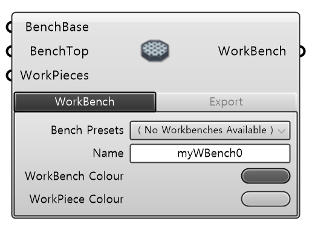
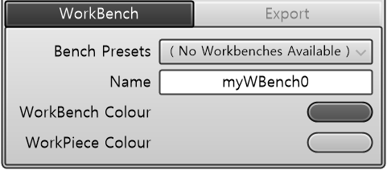
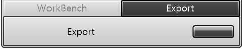

🌐 [KR]( {{ page.translation_link | absolute_url }} ){: .lang-switch }

# Description

A component that allows users to define a custom workbench for a positioner. By applying the modeling of the currently used workbench to the simulation, you can smoothly monitor the positioner working process. In addition, you can work with a complete simulation including the modeling of workpieces on the workbench.

  

# | Input

| Name | Type | Description |
| :--- | :--- | :--- |
| **BenchBase** | Plane | Workbench mounting reference plane relative to the positioner flange |
| **BenchTop** | Plane | Top plane of the workbench |
| **WorkPieces** | Mesh | Workpiece geometry mesh (Optional) |

 
<video src="/assets/images/WorkbenchImporter_gif.mp4" width="576px" height="230px" autoplay=1 muted=1 loop=1 align="center"></video>

## | Required Parameter

  <input type="radio" id="tab1" name="gh-tabs-robot" checked>
  <input type="radio" id="tab2" name="gh-tabs-robot">
  
  <ul class="tab-buttons">
    <li><label for="tab1">WorkBench</label></li>
    <li><label for="tab2">Export</label></li>
  </ul>
  

    <table class="spec-table">
      <thead>
        <tr>
          <th>Name</th>
          <th>Type</th>
          <th>Description</th>
        </tr>
      </thead>
      <tbody>
        <tr>
          <td><strong>Name</strong></td>
          <td>String</td>
          <td>Workbench name</td>
        </tr>
        <tr>
          <td><strong>WorkBench Colour</strong></td>
          <td>Color</td>
          <td>Visualization color</td>
        </tr>
        <tr>
          <td><strong>WorkPiece Colour</strong></td>
          <td>Color</td>
          <td>Visualization color of the workpiece mesh</td>
        </tr>
      </tbody>
    </table>
    
  

  

  

    <table class="spec-table" style="margin: 0;">
      <thead>
        <tr>
          <th>Name</th>
          <th>Type</th>
          <th>Description</th>
        </tr>
      </thead>
      <tbody>
        <tr>
          <td><strong>Export</strong></td>
          <td>Button</td>
          <td>Saves the workbench data as a file to a user-specified local directory.</td>
        </tr>
      </tbody>
    </table>
    
  

  

# | Output

| Name | Type | Description |
| :--- | :--- | :--- |
| **WorkBench** | Workbench | Outputs the defined workbench. |