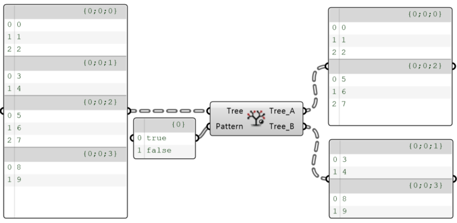

import { Tabs, TabItem, Aside, Steps } from "@astrojs/starlight/components";
import ParamTable from "../../../../components/doc/ParamTable.astro";
import SettingsPanel from "../../../../components/doc/SettingsPanel.astro";
import ComponentShot from "../../../../components/doc/ComponentShot.astro";
import DocTags from "../../../../components/doc/DocTags.astro";
import RelatedLinks from "../../../../components/doc/RelatedLinks.astro";
import * as d from "../../../../data/components/dispatch-branch.mjs";

This is a component that splits the branches of a DataTree into two target DataTrees according to an input pattern.

<DocTags tags={[{ text: "Utils", tone: "accent" }]} />

## Component

<ComponentShot src="/assets/images/0_DispatchBranch.png" alt="Dispatch Branch" />

## Inputs

<ParamTable rows={d.inputs} lang="en" />

## Outputs

<ParamTable rows={d.outputs} lang="en" />

## Examples

<figure class="doc-media">
  
  <figcaption>Pattern {'{'}true, false{'}'} sends the branches alternately to Tree A and Tree B</figcaption>
</figure>

## How to use

<Steps>

1. Connect the DataTree to split to **Tree**.
2. Connect a True / False pattern to **Pattern**; it is applied to the branches in order.
3. Use **Tree A** (True) and **Tree B** (False) separately downstream.

</Steps>

## Related

<RelatedLinks links={[
  { title: "Split Branch", description: "Split branches at a number", href: "/en/utils/splitbranch/" },
  { title: "Tree Branch", description: "Take one branch", href: "/en/utils/treebranch/" },
]} />
