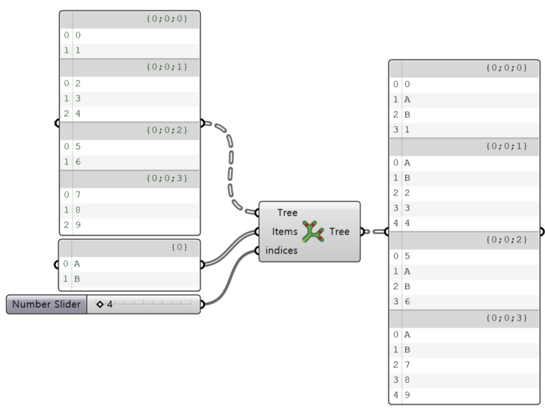
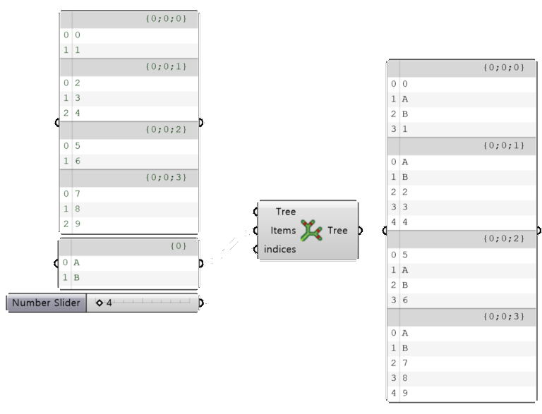

import { Tabs, TabItem, Aside, Steps } from "@astrojs/starlight/components";
import ParamTable from "../../../../components/doc/ParamTable.astro";
import SettingsPanel from "../../../../components/doc/SettingsPanel.astro";
import ComponentShot from "../../../../components/doc/ComponentShot.astro";
import DocTags from "../../../../components/doc/DocTags.astro";
import RelatedLinks from "../../../../components/doc/RelatedLinks.astro";
import * as d from "../../../../data/components/insert.mjs";

This component inserts a collection of data into a DataTree at a given index.

<DocTags tags={[{ text: "Utils", tone: "accent" }]} />

## Component

<ComponentShot src="/assets/images/insert_main.png" alt="Insert" />

## Inputs

<ParamTable rows={d.inputs} lang="en" />

## Outputs

<ParamTable rows={d.outputs} lang="en" />

## Examples

<figure class="doc-media">
  
  
  <figcaption>Items {'{'}A, B{'}'} inserted into each branch of the DataTree</figcaption>
</figure>

## How to use

<Steps>

1. Connect the DataTree to **Tree** and the items to insert to **Items**.
2. Connect the insertion index to **indices**; the items are placed at this position in each branch.
3. Take the DataTree with the items inserted from the **Tree** output.

</Steps>

## Related

<RelatedLinks links={[
  { title: "Dispatch Branch", description: "Split branches by a pattern", href: "/en/utils/dispatch-branch/" },
  { title: "Split Branch", description: "Split branches at a number", href: "/en/utils/splitbranch/" },
]} />
