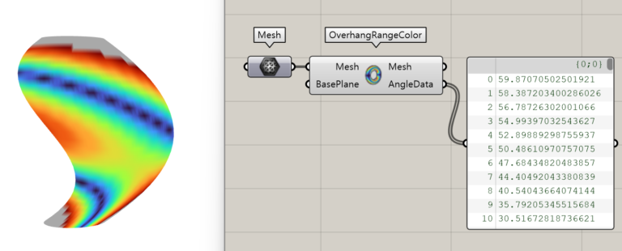
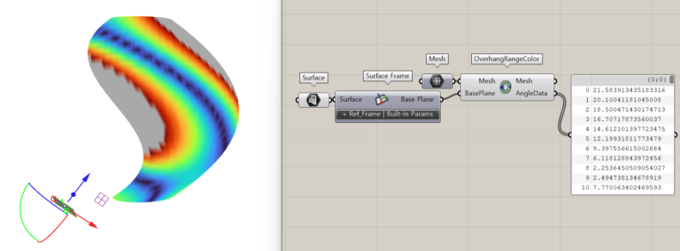

import { Tabs, TabItem, Aside, Steps } from "@astrojs/starlight/components";
import ParamTable from "../../../../components/doc/ParamTable.astro";
import SettingsPanel from "../../../../components/doc/SettingsPanel.astro";
import ComponentShot from "../../../../components/doc/ComponentShot.astro";
import DocTags from "../../../../components/doc/DocTags.astro";
import RelatedLinks from "../../../../components/doc/RelatedLinks.astro";
import * as d from "../../../../data/components/overhangmapper.mjs";

This component visualizes the overhang angles of an input mesh as a colour map.

<DocTags tags={[{ text: "Utils", tone: "accent" }]} />

## Component

<ComponentShot src="/assets/images/overhangmapper_main.png" alt="Overhang Mapper" />

## Inputs

<ParamTable rows={d.inputs} lang="en" />

## Outputs

<ParamTable rows={d.outputs} lang="en" />

## Examples

<figure class="doc-media">
  
  <figcaption>Mesh coloured by overhang angle, with AngleData</figcaption>
</figure>

<figure class="doc-media">
  
  <figcaption>Measured from a tilted reference plane (Surface Frame)</figcaption>
</figure>

## How to use

<Steps>

1. Connect the mesh to check to **Mesh**.
2. Optionally connect a reference plane in the build plate direction to **BasePlane**; for a tilted plate, use a plane from [Surface Frame](/en/utils/surface-frame/).
3. See the overhang areas from the colours of the **Mesh** output, and the angle values in **AngleData**.

</Steps>

## Related

<RelatedLinks links={[
  { title: "Surface Frame", description: "Reference plane from a surface", href: "/en/utils/surface-frame/" },
  { title: "Solid Shell", description: "Shell deposition paths", href: "/en/toolpath/solidshell/" },
]} />
