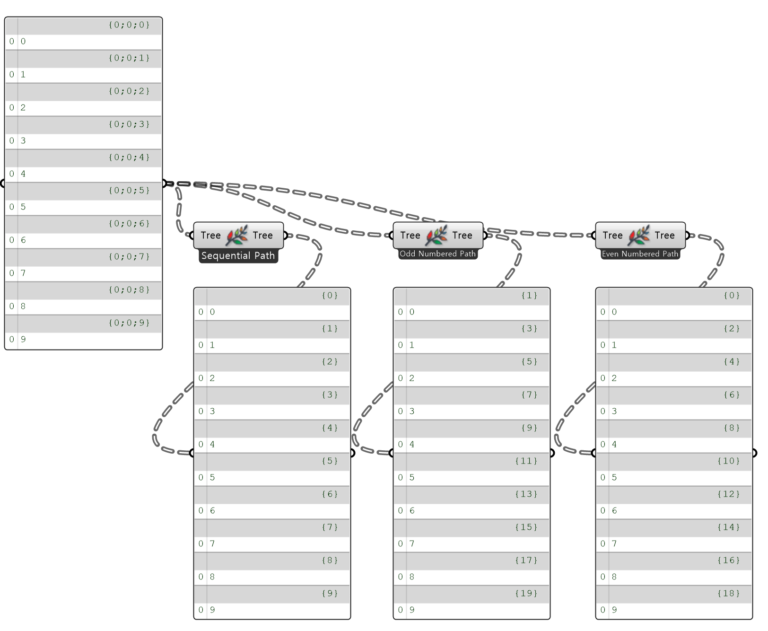
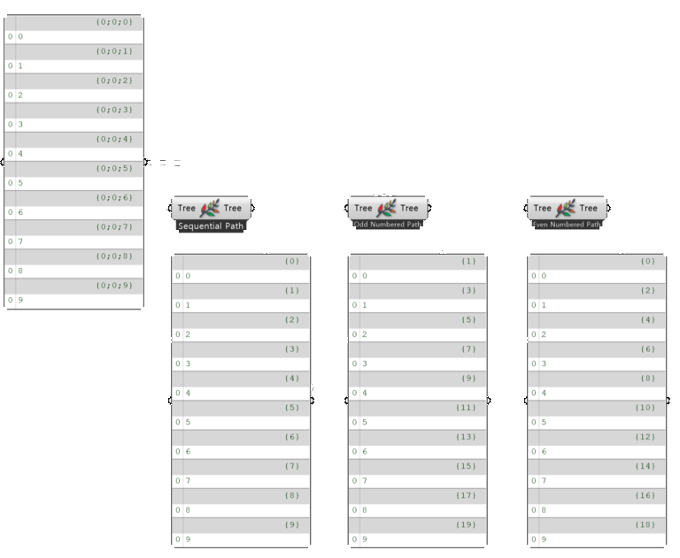

import { Tabs, TabItem, Aside, Steps } from "@astrojs/starlight/components";
import ParamTable from "../../../../components/doc/ParamTable.astro";
import SettingsPanel from "../../../../components/doc/SettingsPanel.astro";
import ComponentShot from "../../../../components/doc/ComponentShot.astro";
import DocTags from "../../../../components/doc/DocTags.astro";
import RelatedLinks from "../../../../components/doc/RelatedLinks.astro";
import * as d from "../../../../data/components/repathtree.mjs";

This component reassigns the branch paths of a DataTree while keeping the branch contents. Right-click the component and pick one of three patterns from the context menu (**Sequential Path** / **Odd Numbered Path** / **Even Numbered Path**). The default is **Sequential Path**.

<DocTags tags={[{ text: "Utils", tone: "accent" }]} />

## Component

<ComponentShot src="/assets/images/repathtree_main.png" alt="Repath Tree" />

## Inputs

<ParamTable rows={d.inputs} lang="en" />

## Outputs

<ParamTable rows={d.outputs} lang="en" />

## Examples

<figure class="doc-media">
  
  
  <figcaption>The same DataTree renumbered as Sequential, Odd Numbered and Even Numbered</figcaption>
</figure>

## How to use

<Steps>

1. Connect the DataTree to **Tree**.
2. Right-click the component and pick the pattern (**Sequential Path** / **Odd Numbered Path** / **Even Numbered Path**).
3. Take the DataTree with reassigned branch paths from the **Tree** output.

</Steps>

## Notes

<Aside type="note">
  **Sequential Path**: assigns the branches {'{'}0{'}'}, {'{'}1{'}'}, {'{'}2{'}'}…. **Odd Numbered Path**: {'{'}1{'}'}, {'{'}3{'}'}, {'{'}5{'}'}…. **Even Numbered Path**: {'{'}0{'}'}, {'{'}2{'}'}, {'{'}4{'}'}….
</Aside>

## Related

<RelatedLinks links={[
  { title: "Extract PathIdx", description: "Read an index from branch paths", href: "/en/utils/extractpathidx/" },
  { title: "Tree Branch", description: "Take one branch", href: "/en/utils/treebranch/" },
]} />
