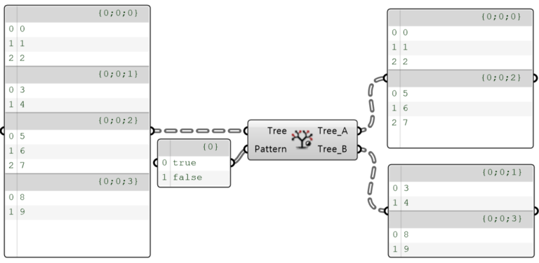
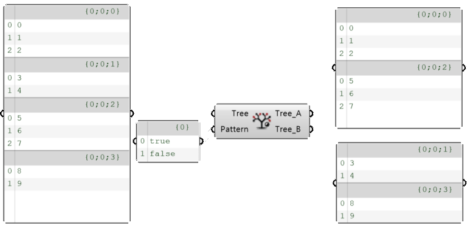

import { Tabs, TabItem, Aside, Steps } from "@astrojs/starlight/components";
import ParamTable from "../../../components/doc/ParamTable.astro";
import SettingsPanel from "../../../components/doc/SettingsPanel.astro";
import ComponentShot from "../../../components/doc/ComponentShot.astro";
import DocTags from "../../../components/doc/DocTags.astro";
import RelatedLinks from "../../../components/doc/RelatedLinks.astro";
import * as d from "../../../data/components/dispatch-branch.mjs";

DataTree 의 Branch 들을 True / False 패턴에 따라 두 개의 DataTree 로 분배하는 컴포넌트이다.

<DocTags tags={[{ text: "Utils", tone: "accent" }]} />

## 컴포넌트

<ComponentShot src="/assets/images/dispatch-branch_main.png" alt="Dispatch Branch" />

## 입력

<ParamTable rows={d.inputs} lang="ko" />

## 출력

<ParamTable rows={d.outputs} lang="ko" />

## 동작 예시

<figure class="doc-media">
  
  
  <figcaption>Pattern {'{'}true, false{'}'} 로 Branch 를 번갈아 Tree A / Tree B 에 나눈 예</figcaption>
</figure>

## 사용 순서

<Steps>

1. **Tree** 에 Branch 를 분배할 DataTree 를 연결한다.
2. **Pattern** 에 True / False 패턴을 연결한다. 패턴은 Branch 순서대로 적용된다.
3. **Tree A**(True) 와 **Tree B**(False) 를 각각 다음 작업에 쓴다.

</Steps>

## 관련 항목

<RelatedLinks links={[
  { title: "Split Branch", description: "순번으로 Branch 나누기", href: "/utils/splitbranch/" },
  { title: "Tree Branch", description: "Branch 하나 꺼내기", href: "/utils/treebranch/" },
]} />
