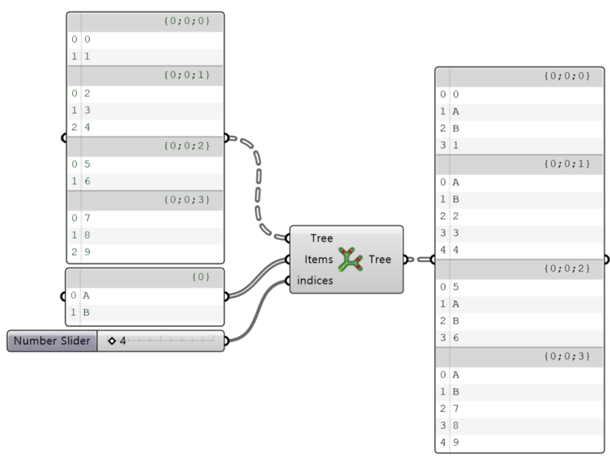
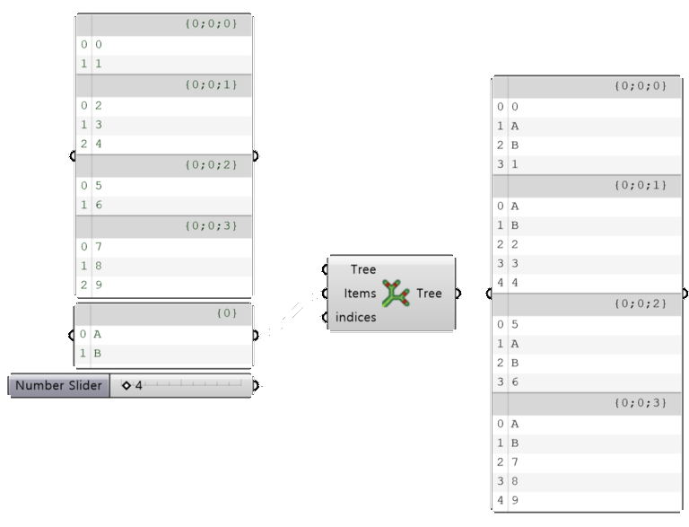

import { Tabs, TabItem, Aside, Steps } from "@astrojs/starlight/components";
import ParamTable from "../../../components/doc/ParamTable.astro";
import SettingsPanel from "../../../components/doc/SettingsPanel.astro";
import ComponentShot from "../../../components/doc/ComponentShot.astro";
import DocTags from "../../../components/doc/DocTags.astro";
import RelatedLinks from "../../../components/doc/RelatedLinks.astro";
import * as d from "../../../data/components/insert.mjs";

데이터 콜렉션을 DataTree 의 지정한 인덱스에 삽입하는 컴포넌트이다.

<DocTags tags={[{ text: "Utils", tone: "accent" }]} />

## 컴포넌트

<ComponentShot src="/assets/images/insert_main.png" alt="Insert" />

## 입력

<ParamTable rows={d.inputs} lang="ko" />

## 출력

<ParamTable rows={d.outputs} lang="ko" />

## 동작 예시

<figure class="doc-media">
  
  
  <figcaption>DataTree 의 각 Branch 에 항목 {'{'}A, B{'}'} 를 넣은 예</figcaption>
</figure>

## 사용 순서

<Steps>

1. **Tree** 에 항목을 삽입할 DataTree 를, **Items** 에 삽입할 항목을 연결한다.
2. **indices** 에 항목을 삽입할 인덱스를 연결한다. 항목은 각 Branch 의 이 위치에 들어간다.
3. **Tree** 출력으로 항목이 삽입된 DataTree 를 받는다.

</Steps>

## 관련 항목

<RelatedLinks links={[
  { title: "Dispatch Branch", description: "패턴으로 Branch 나누기", href: "/utils/dispatch-branch/" },
  { title: "Split Branch", description: "순번으로 Branch 나누기", href: "/utils/splitbranch/" },
]} />
