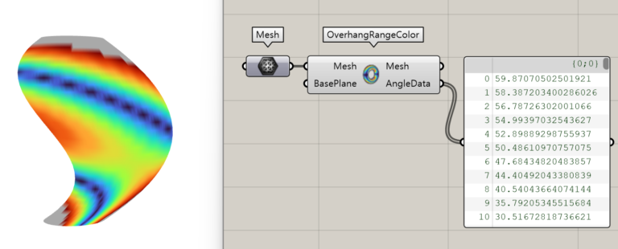
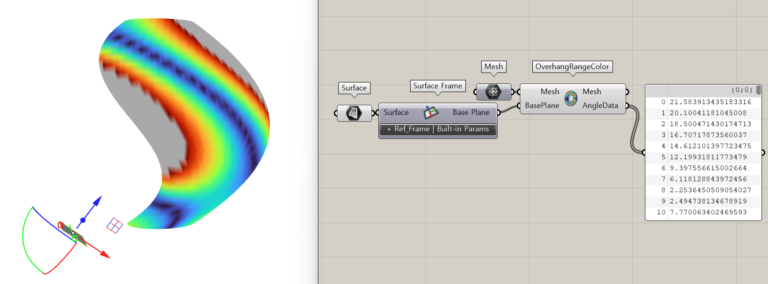

import { Tabs, TabItem, Aside, Steps, LinkCard, CardGrid } from "@astrojs/starlight/components";
import ParamTable from "../../../components/doc/ParamTable.astro";
import SettingsPanel from "../../../components/doc/SettingsPanel.astro";
import ComponentShot from "../../../components/doc/ComponentShot.astro";
import DocTags from "../../../components/doc/DocTags.astro";
import * as d from "../../../data/components/overhangmapper.mjs";

입력된 Mesh 형상의 오버행에 대하여 색상 매핑으로 시각화하여 제공하는 컴포넌트이다.

<DocTags tags={[{ text: "Utils", tone: "accent" }]} />

## 컴포넌트

<ComponentShot src="/assets/images/7_OverhangMapper.png" alt="Overhang Mapper" />

## 입력

<ParamTable rows={d.inputs} lang="ko" />

## 출력

<ParamTable rows={d.outputs} lang="ko" />

## 동작 예시

<figure class="doc-media">
  
  <figcaption>메시의 오버행 각도를 색으로 표시한 결과와 AngleData</figcaption>
</figure>

<figure class="doc-media">
  
  <figcaption>기울인 기준 평면(Surface Frame)으로 잰 결과</figcaption>
</figure>

## 사용 순서

<Steps>

1. **Mesh** 에 오버행을 확인할 메시를 연결한다.
2. **BasePlane** 에 빌드 플레이트 방향의 기준 평면을 연결한다. 기울어진 판이면 [Surface Frame](/utils/surface-frame/) 으로 만든 평면을 쓴다.
3. **Mesh** 출력의 색으로 오버행 구간을 보고, **AngleData** 로 각도 값을 확인한다.

</Steps>

## 관련 항목

<CardGrid>
  <LinkCard title="Surface Frame" description="서피스에서 기준 평면 만들기" href="/utils/surface-frame/" />
  <LinkCard title="Solid Shell" description="외곽 적층 경로 생성" href="/toolpath/solidshell/" />
</CardGrid>
