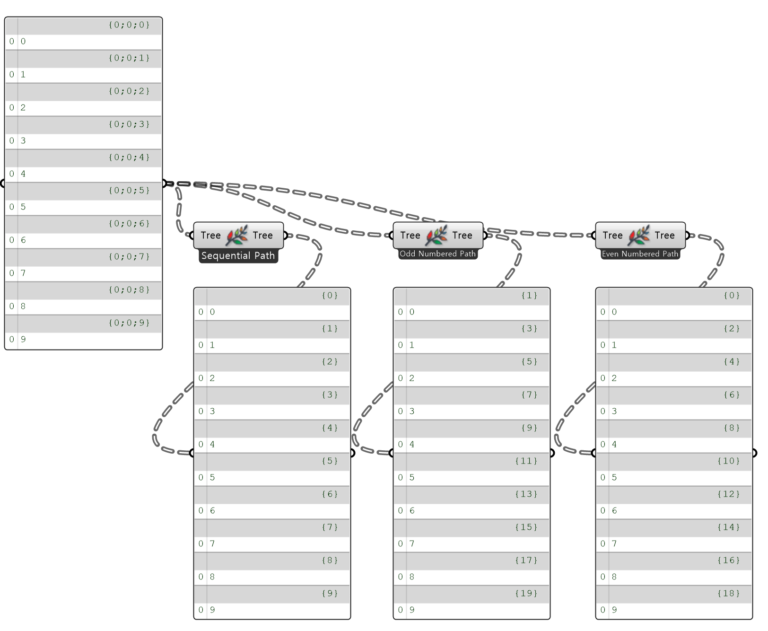

import { Tabs, TabItem, Aside, Steps } from "@astrojs/starlight/components";
import ParamTable from "../../../components/doc/ParamTable.astro";
import SettingsPanel from "../../../components/doc/SettingsPanel.astro";
import ComponentShot from "../../../components/doc/ComponentShot.astro";
import DocTags from "../../../components/doc/DocTags.astro";
import RelatedLinks from "../../../components/doc/RelatedLinks.astro";
import * as d from "../../../data/components/repathtree.mjs";

DataTree 의 Branch 내용은 그대로 두고 Branch Path 만 다시 매기는 컴포넌트이다. 아이콘을 우클릭해 컨텍스트 메뉴에서 세 가지 패턴 중 하나를 고른다.

<DocTags tags={[{ text: "Utils", tone: "accent" }]} />

## 컴포넌트

<ComponentShot src="/assets/images/3_RepathTree.png" alt="Repath Tree" />

## 입력

<ParamTable rows={d.inputs} lang="ko" />

## 출력

<ParamTable rows={d.outputs} lang="ko" />

## 동작 예시

<figure class="doc-media">
  
  <figcaption>같은 DataTree 를 Sequential / Odd Numbered / Even Numbered 로 다시 매긴 결과</figcaption>
</figure>

## 사용 순서

<Steps>

1. **Tree** 에 DataTree 를 연결한다.
2. 아이콘을 우클릭해 패턴(**Sequential** / **Odd Numbered** / **Even Numbered**)을 고른다.
3. **Tree** 출력으로 다시 매긴 DataTree 를 받는다.

</Steps>

## 주의 사항

<Aside type="note">
  **Sequential**: {'{'}0{'}'}, {'{'}1{'}'}, {'{'}2{'}'}… 순번으로 매긴다. **Odd Numbered**: {'{'}1{'}'}, {'{'}3{'}'}, {'{'}5{'}'}… 홀수 순번으로 매긴다. **Even Numbered**: {'{'}0{'}'}, {'{'}2{'}'}, {'{'}4{'}'}… 짝수 순번으로 매긴다.
</Aside>

## 관련 항목

<RelatedLinks links={[
  { title: "Extract PathIdx", description: "Branch Path 의 인덱스 꺼내기", href: "/utils/extractpathidx/" },
  { title: "Tree Branch", description: "Branch 하나 꺼내기", href: "/utils/treebranch/" },
]} />
